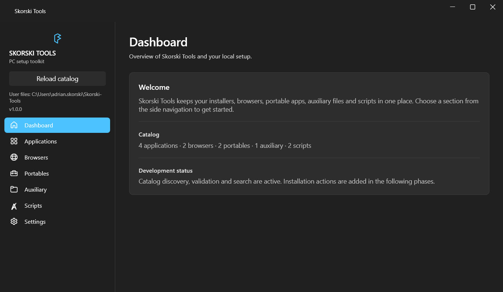
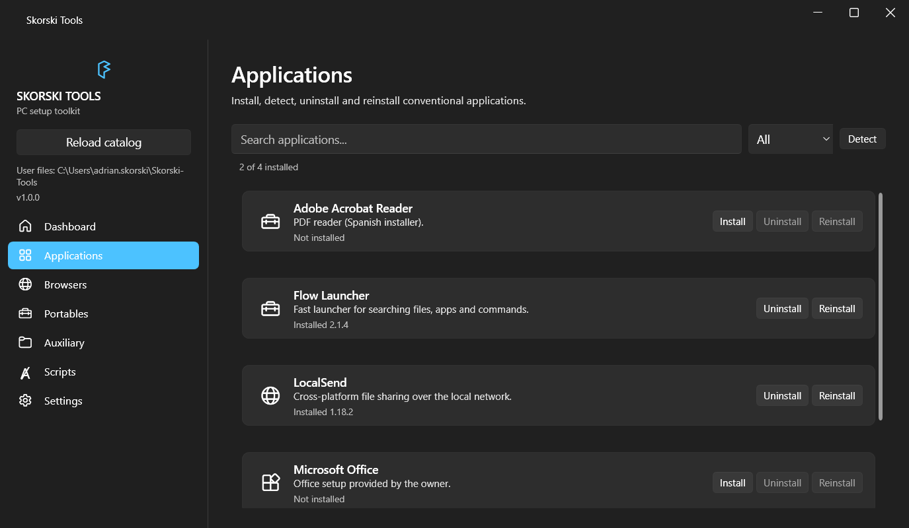
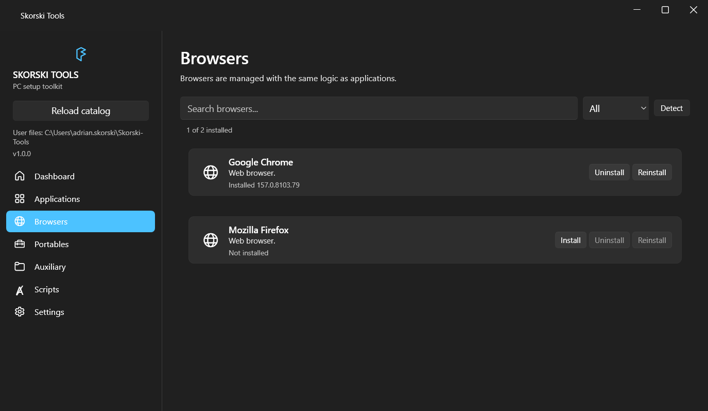
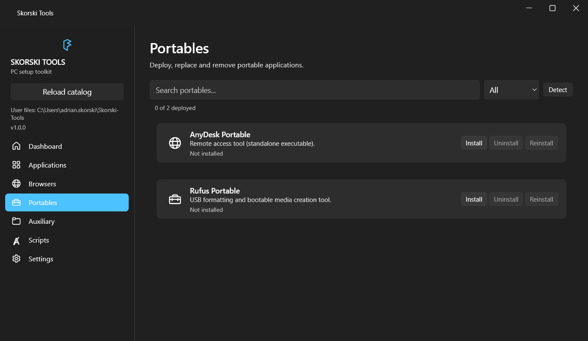
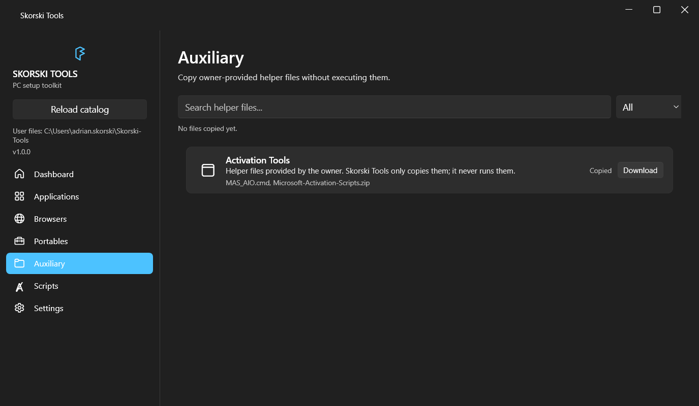
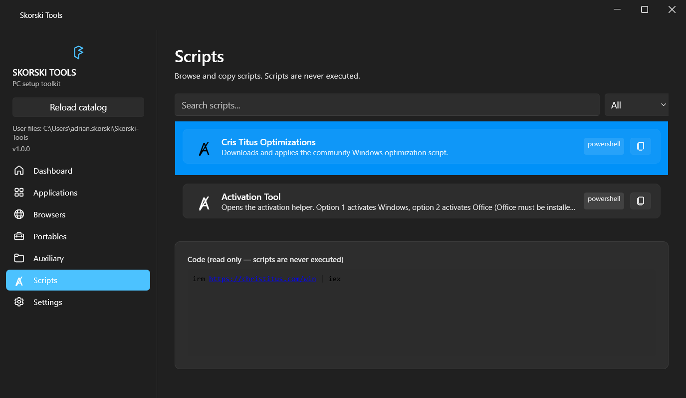
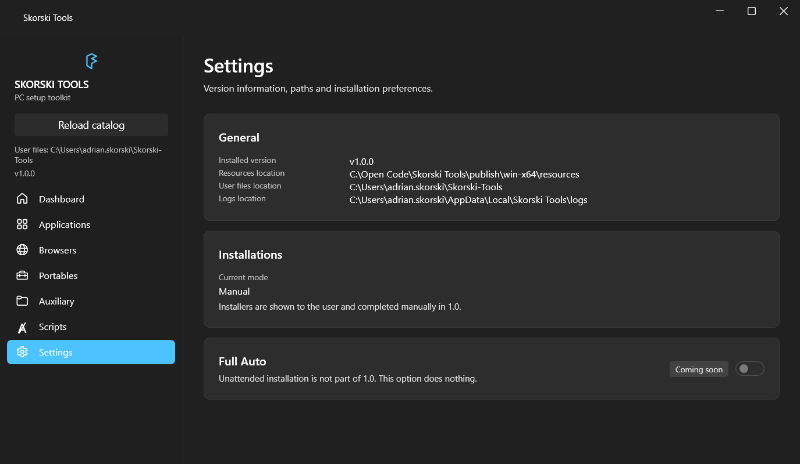

<p align="center">
  
</p>

<h1 align="center">Skorski Tools</h1>

<p align="center">
  <a href="https://github.com/sosizzzz/SkorskiTools/releases/tag/v1.0.0"></a>
  
  
  
</p>

<p align="center">
  <strong>One place to prepare, maintain and configure a Windows PC.</strong><br />
  Skorski Tools gathers your installers, browsers, portable apps, helper files and scripts
  behind a single, clean interface. No hunting for installers, no repeating the same setup
  on every new machine.
</p>

<p align="center">
  <a href="#installation"><strong>Download the installer</strong></a> ·
  <a href="#screenshots">Screenshots</a> ·
  <a href="#features">Features</a> ·
  <a href="#development">Development</a>
</p>

---

## Installation

**[⬇ Download SkorskiTools-Setup.exe (205 MB)](https://github.com/sosizzzz/SkorskiTools/releases/download/v1.0.0/SkorskiTools-Setup.exe)**

Or browse [all releases](https://github.com/sosizzzz/SkorskiTools/releases).

Run the installer and choose the scope when asked:

| Scope | Destination | Requirements |
|---|---|---|
| **Current user** (recommended) | `%LOCALAPPDATA%\Programs\Skorski Tools` | No administrator rights |
| **All users** | `C:\Program Files\Skorski Tools` | UAC confirmation |

Requirements: **Windows 10 or 11, x64**. The .NET 10 runtime is bundled, so nothing
else needs to be installed.

> Skorski Tools itself **never runs as administrator**. Third-party installers handle
> their own UAC prompt. The executable is not code-signed in 1.0, so Windows SmartScreen
> may display a warning — this is expected. Updates are manual: download and run the
> newer installer.

## Screenshots



| Applications | Browsers |
|---|---|
|  |  |

| Portables | Auxiliary |
|---|---|
|  |  |

| Scripts | Settings |
|---|---|
|  |  |

## Features

- **Dynamic catalog** — resources are discovered from `manifest.json` files and
  validated against shipped JSON Schemas. Add an app, browser, portable, helper file
  or script by adding files and a manifest; **no source code changes are required**.
- **Verified resources** — SHA-256 is checked before any file is used, with path-safety
  rules that reject absolute paths and `..` traversal. One invalid resource never
  prevents the rest of the catalog from loading.
- **Applications** — detection through registry (three uninstall locations), MSI
  product code, file existence and installation path. Manual install, uninstall with
  a named confirmation, and repair-style reinstall. Button states always reflect the
  real detected state, and **Detect applications** re-runs the check.
- **Full install** — enable it in Settings to show a checkbox on each application,
  browser and portable. Select the ones you want and press **Full install** to run
  them **sequentially** with their configured silent switches, a `1/3` progress
  counter, a large result message and a notification sound. With **Developer mode**
  enabled in Settings, a **Simulate** button appears: it shows the exact commands,
  hashes, scope and skipped resources without executing anything. Manual buttons are
  unchanged and no switch is guessed. Skorski Tools itself downloads nothing; the
  bundled Office installer does fetch Office files from Microsoft as part of its own
  normal behavior. Installers that cannot run unattended (currently the Firefox stub)
  show a disabled checkbox with an explanatory tooltip.
- **Browsers** — a separate section that reuses the exact same application logic.
  Firefox, Chrome and Brave are included out of the box.
- **Resource details** — selecting an application or browser shows three practical
  benefits stored in its manifest, plus files, hashes and detection source.
- **Portables** — deployed atomically into the user profile, with a desktop shortcut
  to the real executable. Removal warns about data loss and deletes only that
  portable's own folder. Nothing is downloaded from the internet.
- **Auxiliary** — owner-provided files are copied after hash verification, intact.
  **They are never executed.**
- **Scripts** — read-only, syntax-highlighted viewer (AvalonEdit) with a one-click
  clipboard copy. **Scripts are never executed.**
- **Transparency** — Serilog rolling logs in `%LOCALAPPDATA%\Skorski Tools\logs\`
  record operations, detection results, invalid manifests and hash mismatches. The
  in-app **History** page shows install/uninstall/reinstall results, and selecting any
  resource shows its files, hashes, detection source and manifest path.
- **Dark Fluent UI** — built with WPF and WPF-UI, designed for clarity and speed.

## Adding a resource

Everything the app shows comes from `resources/`:

```text
resources/
├── categories.json
├── schemas/                     JSON Schemas for every manifest type
├── installers/<id>/manifest.json + installer files
├── browsers/<id>/manifest.json   + installer files
├── portables/<id>/manifest.json  + package and executable
├── auxiliary/<id>/manifest.json  + helper files
└── scripts/scripts.json
```

Drop a valid manifest in the right folder and press **Reload catalog** in the
sidebar — the item appears automatically. See [`docs/decisions.md`](docs/decisions.md)
for the manifest rules.

## Project structure

```text
src/
├── SkorskiTools.Core/     models, validation, detection and services (no UI)
├── SkorskiTools.App/      WPF views, view models, themes, behaviors and assets
└── SkorskiTools.Tests/    xUnit tests for Core
resources/                 catalog data and original owner-provided files
installer/                 Inno Setup script
docs/                      decisions, verification report and screenshots
```

Architecture is MVVM with CommunityToolkit.Mvvm. Business logic lives in Core and
system operations are behind interfaces so they can be tested. There is no business
logic in visual controls.

## Development

Requirements: .NET SDK 10.0+ on Windows.

```powershell
git clone https://github.com/sosizzzz/SkorskiTools.git
cd SkorskiTools

dotnet restore SkorskiTools.sln
dotnet build SkorskiTools.sln -c Debug
dotnet test SkorskiTools.sln -c Debug
```

For a quick launch of the already-built Debug app, double-click `run-app.cmd`.

To produce the release artifacts:

```powershell
dotnet publish src/SkorskiTools.App/SkorskiTools.App.csproj -c Release -r win-x64 --self-contained true -o publish/win-x64
& "$env:LOCALAPPDATA\Programs\Inno Setup 6\ISCC.exe" installer\SkorskiTools.iss
```

The installer is written to `installer\output\SkorskiTools-Setup.exe`.

## Security model

- Least privilege: the app never requests elevation; installers do it themselves.
- No arbitrary code from manifests; scripts and auxiliary files are never run.
- Arguments are passed as lists, never concatenated strings.
- Destructive operations require an explicit, named confirmation.
- Files outside the planned user folders are not modified.

## Documentation

- [Technical decisions](docs/decisions.md)
- [Silent-install candidate catalog](docs/catalog-candidates.md)
- [Feature suggestions](docs/suggestions.md)
- [Final verification report](docs/verification.md)
- [Release notes](docs/release-notes.md)

## Roadmap (after 1.0)

- **Skorski's Config** — optional, user-level browser configuration (not enterprise policy). See `docs/roadmap.md`.

Full install was added after 1.0. Skorski's Config is intentionally not implemented
yet: there is no placeholder button or partial implementation that could be
activated by accident.

---

Personal project by [@sosizzzz](https://github.com/sosizzzz), built as a portfolio
showcase.
